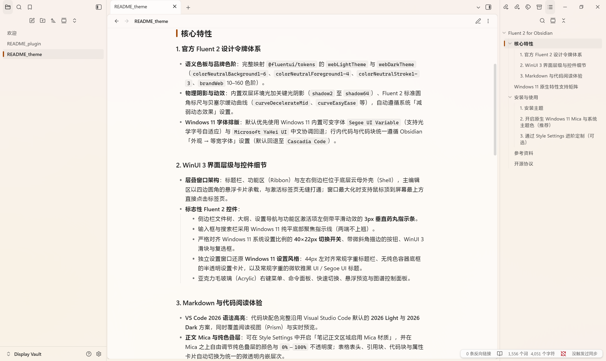

在 Windows 11 上长期使用 Obsidian 时，总有一种轻微的割裂感：桌面和系统设置早已全面过渡到柔和的云母（Mica）层次、圆润的控件与细腻的动效，而笔记软件本身却仍停留在传统 Web 面板的观感里。

为了解决这个问题，我基于微软官方的 **Fluent 2 Design System**（Fluent UI v9 与 Windows 11 WinUI 3 规范），从零打磨了一套 Obsidian 主题 **[Fluent 2](https://community.obsidian.md/themes/fluent-2)**，并专门编写了一个零依赖的桌面配套插件 **[Fluent 2 Windows Native](https://community.obsidian.md/plugins/fluent-windows-native)**。目前主题与插件均已正式上架 Obsidian 官方社区市场，欢迎体验。

## 为什么是「主题 + 配套插件」的组合？

在研究 Windows 11 特性与 Electron 渲染机制的过程中，可以很清楚地划出一条边界：

- **纯 CSS 主题可以做到极致的部分**：色彩与语义令牌、物理阴影与圆角标尺、WinUI 3 控件细节、字体排版、代码高亮、对比度主题与系统减弱动态效果适配；
- **纯 CSS 无法触及的系统级能力**：Electron 窗口底层的 Windows 11 原生 **Mica / Mica Alt / Acrylic** 材质，以及 Windows 11 个性化设置里的实时 **7 阶系统主题色**（Windows 下 Chromium 的纯 CSS `AccentColor` 通常会回退到默认蓝色，无法反映系统真实配色）。

因此，我将这套体验拆成两层：主题本身开箱即用，未装插件时会自动回退为纯 CSS 拟真云母（Simulated Mica）；在 Windows 11 上搭配轻量配套插件后，即可解锁完整的原生系统质感，也无需再额外依赖 Pseudo Mica 等第三方透明插件。

## 主题亮点：Fluent 2 for Obsidian

### 1. 完整映射微软官方 Fluent 2 设计令牌

主题完整引入了 `@fluentui/tokens` 的浅色（`webLightTheme`）与深色（`webDarkTheme`）语义体系，包含中性层级背景、前景、描边、官方 `brandWeb` 品牌色阶、双层环境光加关键光阴影（`shadow2` 至 `shadow64`）以及标准贝塞尔缓动曲线。

在无障碍体验上，主题原生支持 Windows 对比度主题（`@media (forced-colors: active)`）与系统「减弱动态效果」（`@media (prefers-reduced-motion: reduce)`）。

### 2. WinUI 3 窗口层级与 Edge 风格无缝标签页

- **层叠式工作区**：标题栏、功能区与左右侧边栏位于底层云母外壳，主编辑区以圆角悬浮卡片承载，与激活标签页融为一体；
- **Edge 同款外倒圆角标签页**：活动标签页底部采用 `10px` 矢量 SVG 反凹弧脚，与下方正文区无缝衔接，且窗口最大化时支持鼠标顶到屏幕最上沿（`y = 0`）直接点击切换；
- **标志性 Windows 11 控件细节**：
  - 侧边栏文件树、大纲、设置导航与功能区激活项左侧带自适应高度的 **3px 垂直胶囊指示条**；
  - 严格对齐 Windows 11 系统设置比例的 **40×22px 切换开关**（含悬停放大与按压单侧拉伸动效）；
  - 输入框、搜索栏、笔记内联标题与侧栏重命名统一采用 **底部 2px 纯平主题色聚焦横线**，拒绝生硬的四边矩形外框；
  - 深度定制 Obsidian 1.15+ 独立设置窗口，还原 Windows 11 设置的 44px 左对齐常规字重标题栏与半透明圆角设置卡片。

### 3. 舒适的阅读、排版与代码体验

- **Windows 11 原生字体链路**：默认优先调用 `Segoe UI Variable`（支持光学字号自适应）配合 `Microsoft YaHei UI` 中文回退；代码块与行内代码统一遵循 Obsidian 等宽字体设置，默认使用 `Cascadia Code` / `Cascadia Mono` 并为中文补充微软雅黑回退，避免中文掉回宋体；
- **VS Code 2026 语法高亮**：代码块配色完整沿用 Visual Studio Code 默认的 **2026 Light** 与 **2026 Dark** 方案，同时覆盖阅读视图与实时预览；
- **统一的内嵌层次与正文 Mica 叠层**：代码块、引用块、表格表头与笔记属性卡片采用统一的微透明内嵌背景；通过 Style Settings 还可以开启「笔记正文区域启用 Mica 材质」，并自由调节叠层颜色与 `0%` 至 `100%` 不透明度，顶部选中标签也会同步联动变化；
- **更多贴心可选项**：支持在 Style Settings 中分别控制阅读视图与编辑视图（实时预览）是否在图片正下方居中显示自定义图名，以及标题样式、紧凑侧栏密度等定制项。

## 配套插件：Fluent 2 Windows Native

**[Fluent 2 Windows Native](https://community.obsidian.md/plugins/fluent-windows-native)** 是一个零外部依赖的桌面端专用插件，只专注做好两件事：

1. **全窗口原生 Windows 11 材质**：直接调用 Electron 原生的 `BrowserWindow.setBackgroundMaterial`，支持在 **Mica（云母）**、**Mica Alt（标签式云母）** 与 **Acrylic（亚克力）** 之间切换，并且同时覆盖主窗口、弹出笔记窗口以及 **Obsidian 1.15+ 独立设置窗口**；
2. **实时同步 7 阶 Windows 11 系统主题色**：通过只读方式查询 Windows 注册表 `HKCU\Software\Microsoft\Windows\CurrentVersion\Explorer\Accent` 下的 `AccentPalette`，提取系统生成的完整 7 阶强调色板（`light3` 到 `dark3`），并自动计算高对比度前景色注入到所有窗口。当你在 Windows 系统设置里切换主题色时，Obsidian 会在聚焦或轮询时自动跟随变色。

安全与隐私方面，插件完全在本地离线运行，无任何网络请求与数据收集，仅在 Windows 下执行只读的 `reg.exe query` 命令读取个性化配色。

## 安装与配置指南

### 第一步：安装主题

在 Obsidian 中打开 **设置 → 外观 → 主题 → 管理**，搜索 **Fluent 2** 安装并启用（也可直接访问 [Obsidian 官方主题页](https://community.obsidian.md/themes/fluent-2) 或 [GitHub 仓库](https://github.com/zyraxi21/Fluent-2-Obsidian)）。

### 第二步：安装配套插件（Windows 11 强烈推荐）

在 **设置 → 第三方插件 → 社区插件市场** 中搜索 **Fluent 2 Windows Native**（也可直接访问 [Obsidian 官方插件页](https://community.obsidian.md/plugins/fluent-windows-native) 或 [GitHub 仓库](https://github.com/zyraxi21/fluent2-windows-native)），安装并启用。

> 小提示：为了获得最完整的 Windows 11 沉浸式标题栏体验，建议在 **设置 → 界面 → 窗口边框样式** 中保持 **隐藏（默认）**；同时确认 Windows 系统「设置 → 个性化 → 颜色 → 透明效果」处于开启状态。

### 第三步：配合 Style Settings 进阶定制（可选）

如果希望进一步调整「笔记正文区域启用 Mica 材质」、叠层颜色与不透明度、图片下方居中图名、标题装饰线或紧凑侧边栏密度，可以安装社区插件 **Style Settings**，在其中展开 **Fluent 2** 分组即可实时预览调整。

## 相关链接与开源协议

- **主题市场页面**：[Fluent 2 - Obsidian Theme](https://community.obsidian.md/themes/fluent-2)
- **主题源码仓库**：[zyraxi21/Fluent-2-Obsidian](https://github.com/zyraxi21/Fluent-2-Obsidian)
- **插件市场页面**：[Fluent 2 Windows Native - Obsidian Plugin](https://community.obsidian.md/plugins/fluent-windows-native)
- **插件源码仓库**：[zyraxi21/fluent2-windows-native](https://github.com/zyraxi21/fluent2-windows-native)
- **开源协议**：两者均采用 GNU General Public License v3.0（GPL-3.0）开源。

欢迎在使用过程中通过 GitHub Issue 反馈建议或问题，希望这套主题和插件能让 Obsidian 成为你 Windows 11 桌面上最顺眼、最顺手的原生级应用之一。